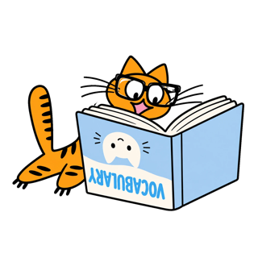
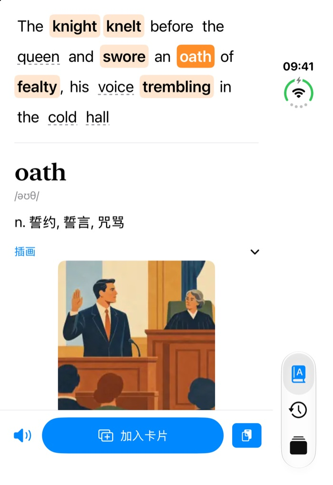
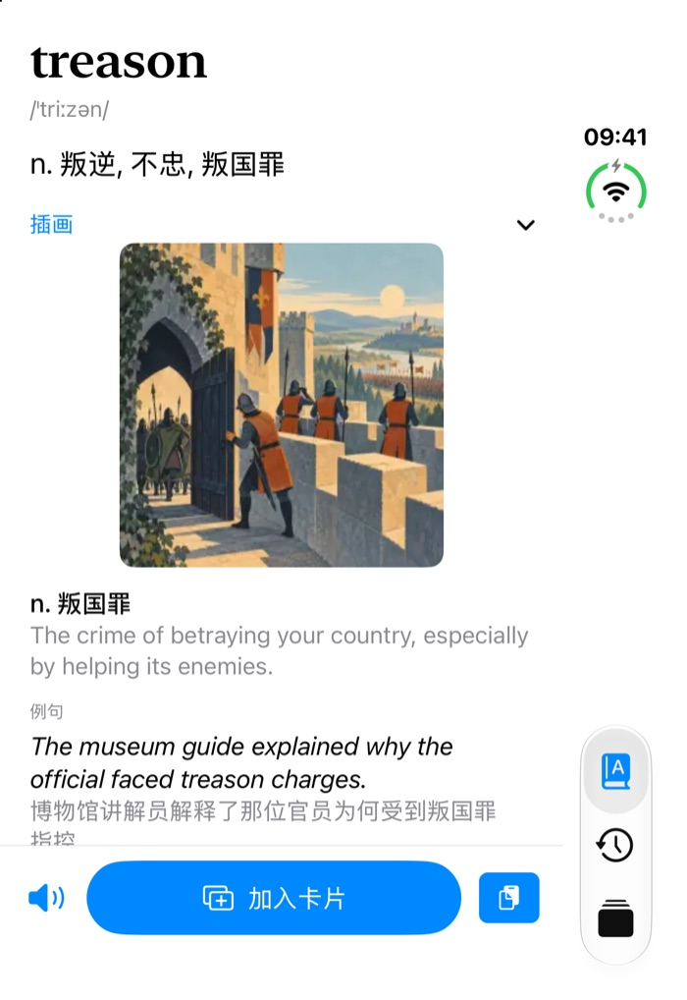
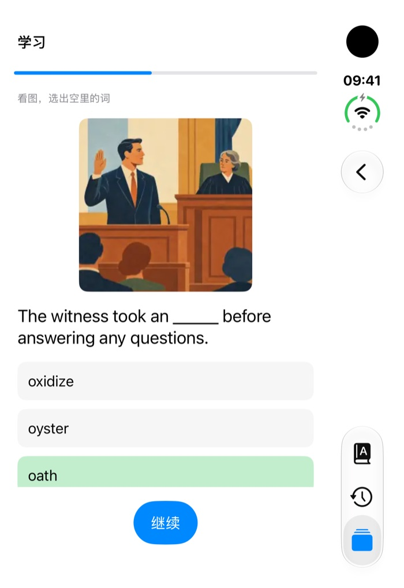

<p align="center"></p>

# 三脚猫背单词

左半屏看书，右半屏查词。给 iPhone 折叠屏分屏阅读做的英语查词和背词 App：在书里拷贝一个词，右边马上出中文释义；顺手做成卡片，按记忆曲线每天复习。词典装在 App 里，不联网也能用。

介绍页：<https://yxh-ggboys.github.io/tripawords/>

<p align="center">
  
  
  
</p>

## 功能

- 拷贝就查：App 在屏幕上时，拷贝一个词，右边自动显示释义。`fled` 还原成 `flee`，人名地名跳过，网址、数字、中文忽略。
- 整句标词：拷贝一整句，常用 2000 词以外的词标成橙色，其他实词带虚线，点哪个看哪个。
- 7,298 个词带插画、例句、搭配（来自 Word Atlas），其余词用 ECDICT 的简明释义，共 54,825 个词条。
- 卡片记下拷贝时的原句和来源书名，能搜索。
- 复习用 FSRS-6 排程。带插画的词有四种题型：选中文意思、看图补句、听音选词、看图拼写；其他词用翻卡。
- 不联网，没有账号、服务器、统计。只在 App 显示在屏幕上时读剪贴板，可以随时暂停。

## 自己编译

需要 Xcode 27、iOS 27.0 以上的 iPhone、[XcodeGen](https://github.com/yonaskolb/XcodeGen)、Python 3.9 以上。

```bash
# 1. 下载词典原始数据（Word Atlas 约 84 MB）
mkdir -p pipeline/raw/ecdict pipeline/out
curl -L -o pipeline/raw/ecdict/ecdict.csv https://raw.githubusercontent.com/skywind3000/ECDICT/master/ecdict.csv
git clone --depth 1 --filter=blob:none --sparse https://github.com/designfuchen/word-atlas.git pipeline/raw/word-atlas-repo
git -C pipeline/raw/word-atlas-repo sparse-checkout set public/atlas/thumb data

# 2. 生成 App 内置词库 pipeline/out/foldpilot.sqlite
python3 -I pipeline/scripts/build_brief_db.py pipeline/raw/ecdict/ecdict.csv pipeline/out/foldpilot.sqlite
python3 -I pipeline/scripts/build_atlas_db.py pipeline/raw/word-atlas-repo/data/word-atlas.json pipeline/raw/word-atlas-repo/public/atlas/thumb pipeline/out/foldpilot.sqlite

# 3. 生成 Xcode 工程
xcodegen generate
open FoldPilot.xcodeproj
```

在 Xcode 的 Signing & Capabilities 里选你自己的开发团队，把 Bundle Identifier 改成你自己的，连上 iPhone 运行。

## 授权

代码以 [MIT 协议](LICENSE)开源。

「三脚猫背单词」这个名字和橘猫 logo 是 Han 的原创作品，保留所有权利，不在 MIT 授权范围内：只用于本项目，不得用在其他 App、网站或产品里；复刻时请换成你自己的名字和图标。详见 [LICENSE](LICENSE)。

用到的开源项目：

- [Word Atlas](https://github.com/designfuchen/word-atlas)：插画、中文义项、例句、搭配、词族，CC BY 4.0，署名 Word Atlas contributors；我们改动了排版和数据格式。学习流程和题型参照它的代码（MIT）改写成 Swift。
- [ECDICT](https://github.com/skywind3000/ECDICT)：简明释义、词频、词形变化，MIT。
- [swift-fsrs](https://github.com/open-spaced-repetition/swift-fsrs)：FSRS 复习排程，MIT。
